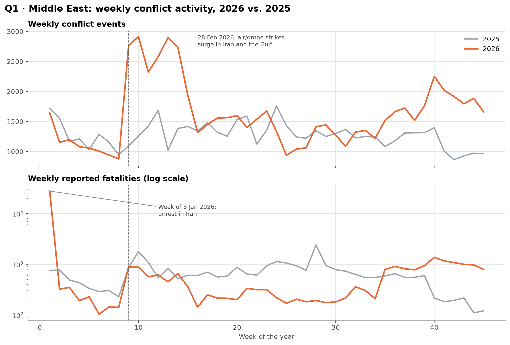

# The 2026 Escalation in the Middle East

An analysis of ACLED conflict data for the Middle East, comparing **2026 with 2025**. It looks at **when** the 2026 escalation started, **where** it happened, **how** the type of violence changed and **how deadly** it was.


| File | What it is |
|---|---|
| [`middle_east_2026_escalation.ipynb`](middle_east_2026_escalation.ipynb) | **The hand-in.** Jupyter notebook with the code, plots, research questions and answers |
| [`app.py`](app.py) | **Presentation dashboard** (Streamlit, interactive) |
| [`figures/`](figures) | All plots exported as PNG |
| `middle_east_2026_escalation.html` | The notebook as a web page (opens without Jupyter) |
| `requirements.txt` | Python packages needed |

## Research questions

1. **Timing:** How did weekly conflict events and fatalities develop in 2026 compared with 2025, and when did the escalation start?
2. **Countries:** Which countries were most affected in 2026, and how does this compare with 2025?
3. **Iran:** How did the type of conflict in Iran change during 2026?
4. **Spillover:** Did the conflict spread to the Gulf states (Bahrain, Kuwait, Qatar, UAE, Oman, Saudi Arabia), and when?
5. **Lethality:** Which types of events were the deadliest (fatalities per event) in 2026 compared with 2025?

## Key findings

* In weeks 1–45, the region recorded **+26% events** and **+63% reported fatalities** compared with the same weeks of 2025. Even against *all* of 2025, 2026 still shows +12% events and +57% fatalities.
* The escalation started in the **week of 28 February 2026**, when weekly events jumped from about 1,100 to about 2,700.
* **All six Gulf states** recorded their first air/drone strike events of 2026 in that same week: **486** such events in 2026, compared with 6 in 2025.
* In **Iran**, the conflict changed from a **protest and riot wave in January** to an **external strike campaign from late February**.
* A single week (Iran, 3 January 2026) accounts for 57% of all recorded fatalities in 2026. A sensitivity check shows how much this one outlier affects the results.



## Data

* **Source:** [ACLED – Armed Conflict Location & Event Data](https://acleddata.com), *Middle East aggregated data* (weekly, by province), data up to the week of 2026-11-07, downloaded November 2026.
* **Citation:** Raleigh, C., Linke, A., Hegre, H. & Karlsen, J. (2010). *Introducing ACLED: An Armed Conflict Location and Event Dataset.* Journal of Peace Research, 47(5), 651–660.
* The full file has 156,865 rows (2015–2026). The analysis uses the **31,288 rows from January 2025 to November 2026**.

> **The data file is not included in this repository.** To run the code, download the Middle East aggregated data from [acleddata.com](https://acleddata.com) (Data Export Tool → Aggregated data). Save it in this folder as
> `Middle-East_aggregated_data_up_to_week_of-2026-11-07.xlsx`.

## How to run

Install the required packages (once):

```bash
pip install -r requirements.txt
```

**Notebook:** open `middle_east_2026_escalation.ipynb` in Jupyter or VS Code and run all cells. The plots are also saved to `figures/`.

**Dashboard:**

```bash
streamlit run app.py
```

Then open http://localhost:8501. The first start takes about 30 seconds because the app reads the Excel file. After that it saves a faster copy (`acled_2025_2026_cache.parquet`) and starts in a few seconds.

## Limitations

ACLED counts *reported* events, so coverage depends on media access, especially in Iran and Yemen. Fatality figures are estimates. Whether a demonstration is coded as a protest or a riot depends on how the sources describe it. The aggregated data contains no information about the actors involved, so the analysis describes *what* happened, *where* and *when*, but not *who* was responsible.
